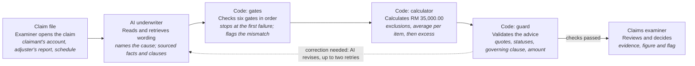

# Fire Policy Underwriter Advisor

An AI underwriter that advises a fire insurance claims examiner, gate by gate. It reads the claim file, retrieves the policy wording ranked by authority, and supplies each gate's facts with their source. Code sets every gate status and the figure, a guard checks the advice before it is recorded, and the claims examiner decides.

The system reviews 22 claims across 11 perils, each with its own endorsements. It retrieves the relevant policy wording and ranks the clauses by authority.

**Open `demo.html`** in any browser: the claim file for all 22 claims, in five tabs (incident report, adjuster's report, policy schedule, underwriter's advice, under the hood). No server, no key, no install. **`answer-key.html`** holds the expected result for every claim, written before the build.

## How one claim flows

The Kuantan burst pipe, CLM-2025-09207, as recorded in its run:



The six gates, in order; the first failure decides: **1** Period of insurance, **2** Peril insured, **3** Conditions precedent, **4** Endorsement held, **5** Endorsement satisfied, **6** Item admitted.

## Who produces each part of the advice

| Part | Produced by |
|---|---|
| Gate status | Code, `check_gate`, from the tests in `rules/condition_tests.json` |
| Wording quoted | Retrieval, word for word, with its chunk id |
| Proximate cause at gate 2 | The AI names it from the adjuster's report; code tests whether it is insured anywhere in the policy |
| Facts | The AI, each with the document and section it came from |
| Application and explanation | The AI |
| Underwriting flag | Code sets `pass_flagged`; the AI writes the flag with the scope note |
| Figure | Code, `calculate_payable`: exclusions, then Condition 20 average per schedule item, then the excess after average |
| Governing clause | Code, the clause the deciding gate rests on; the guard holds the advice to it |
| The decision | The claims examiner |

## The MCP server

`mcp_server.py` (Python `mcp` package) serves the claim file as resources and the work as four tools.

| Resources | |
|---|---|
| `claim://{claim_no}/incident` | The claimant's WhatsApp or email thread |
| `claim://{claim_no}/adjuster` | The adjuster's investigation, findings and measurement |
| `claim://{claim_no}/schedule` | Period, sums insured, endorsements and clauses held |
| `policy://clause/{code}` | One clause of the wording, with its scope note |

| Tool | What it does |
|---|---|
| `search_policy` | Vector search (all-MiniLM-L6-v2 in Qdrant) beside a keyword (BM25) pool, a cross-encoder rerank, then precedence by authority against the open claim's schedule: an endorsement not held cannot override. Lookup by clause code. An empty result is a valid answer; a search that cannot run returns `search_unavailable`, retryable. |
| `check_gate` | Applies the gate's test to the facts given and returns pass, fail or pass_flagged. Gates run 1 to 6 and stop at a failure; a gate rests only on wording retrieved for this claim; every fact needs its source. |
| `calculate_payable` | Prices the claim after the gates. A declined claim gets a but-for figure, labelled not payable, where there is cover to price. |
| `submit_advice` | The guard: every quote must be in retrieved wording and cite its own chunk; every status, the governing clause and the figure must match what code set. A fault is sent back with the line named, up to two retries. |

Every call is logged per claim, and the benchmark scores the run from that log.

## Results

22 claims across 11 perils, written before the build and checked by an independent reviewer: 22 of 22 on proximate cause, every gate status, the governing clause and the figure to the ringgit, with every piece of advice recorded by the guard. Claude Haiku 5.5 answers 21 claims and Claude Sonnet 5.5 answers one (Alor Setar). Recorded API spend for every run: USD 0.43.

| Peril | Claims | Passed |
|---|---|---|
| Burglary | 1 | 1 |
| Burst pipe | 2 | 2 |
| Electrical fault | 1 | 1 |
| Falling tree | 1 | 1 |
| Fire | 6 | 6 |
| Flood | 3 | 3 |
| Impact | 1 | 1 |
| Lightning | 2 | 2 |
| Riot and malicious damage | 2 | 2 |
| Storm | 2 | 2 |
| Subsidence and landslip | 1 | 1 |

61 tests that need no API key run through the MCP client before any paid run: every structured error, an empty search and a search that is down, the guard's checks and retries, and all 22 claims reproducing their expected gates and figures from reference facts.

Before real users, Version 1 still needs a security review, a named owner for monitoring and incidents, the insurer's own wording and schedules, and the claims manager's approval.

## What is here

```
demo.html              the claim file page: 22 claims, five tabs, frozen results
answer-key.html        the expected result for every claim
mcp_server.py          the MCP server: 4 resources, 4 tools, the tool log
agent.py, prompt.py    the underwriter: a tool loop on the Anthropic SDK and its prompt
engine/                gates, calculator, guard, retrieval, policy search, claim file
rules/                 condition_tests.json, the gate tests held as data
data/chunks.json       117 clauses of the policy wording, with scope notes
cases/                 22 claim files: incident, adjuster, schedule, expected result
benchmark/             cases.json, gold_facts.json, test_tools.py, run_benchmark.py, runs/
build/                 chunker, cases builder, claim file page builder, answer key builder
```

## Running it

```bash
pip install mcp anthropic qdrant-client sentence-transformers
python benchmark/test_tools.py                     # no key: 61 tool tests
python benchmark/run_benchmark.py --sample         # 3 claims on Claude Haiku 5.5
python benchmark/run_benchmark.py                  # all 22 claims
python build/build_demo.py --run <run_id>          # the claim file page from a recorded run
```

`run_benchmark.py` runs the no-key tests first and refuses to spend if one fails, and stops at a USD 2.00 ledger. The API key is read from the environment; the MCP server never sees it.

The chunker (`build/chunk_policy.py --pdf <file>`) needs the source policy PDF, a third-party document that is not redistributed here. `data/chunks.json` is its built output, so everything else runs without it.
