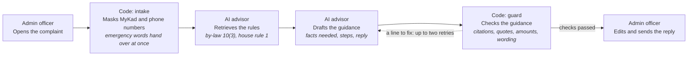

# Strata Complaint Advisor

An AI advisor for the admin officer of a Malaysian condominium. When a resident complains, the officer opens the complaint on the advisor screen and gets guidance before acting: the facts still needed, the rules that apply with a clickable citation to each passage, the next steps tied to the building's complaint procedure, a draft reply, and a handover note to the building manager when one of five fixed reasons applies.

The setting is Amber Residences, a sample condominium of four blocks and 608 units under one management corporation. The rules come from the English Strata Management Act 2013 and the Strata Management (Maintenance and Management) Regulations 2015, the sections the 20 sample complaints need, and the building's own sample additional by-laws, house rules, complaint SOP and reply templates.

**Open `demo.html`** in any browser: the advisor screen, replaying the recorded run of each of the 20 sample complaints, with no server and no key. **`documents.html`** holds every passage the advisor can cite. **`answer-key.html`** holds what the advisor must do on each complaint, written before the build, and how each run scored it.

## How one complaint flows

Case 1, loud music late at night:



## Who does what

| Part | Done by |
|---|---|
| Masking, emergency check | Code, before any AI call |
| Which documents can be searched | Code: the building, approved, in force on the complaint date |
| Rule order | Code: the Act, the Regulations and Third Schedule, the additional by-laws, the house rules |
| Which rules apply and how; the draft reply | The AI |
| Citations, quotes, amounts, breach wording, SOP steps, handover reasons, conflicts | Code, the guard on `submit_guidance` |
| The handover note | Code, from the accepted guidance |
| Sending the reply, enforcing a rule, any payment | The officer and the building manager |

## Live mode

```bash
pip install anthropic mcp qdrant-client sentence-transformers
set ANTHROPIC_API_KEY=<your own key>     # that account is billed: use a key with a spending limit
python serve.py                          # http://localhost:8757
```

## Tests

```bash
python benchmark/test_tools.py           # no key: every tool, every guard check, the intake, the scorer
python benchmark/test_mcp.py             # no key: the MCP server round trip
python benchmark/run_benchmark.py --sample
```

Built by Lee Yih Ven. Sample building, unit register and complaints.
